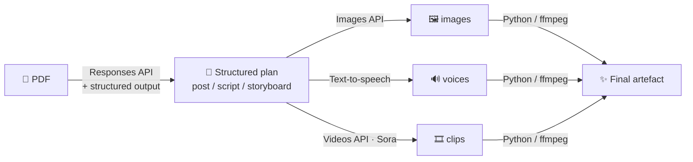

# 📄➡️🎬 Paper Remix

**A hands-on workshop: take a research paper (PDF) and turn it into something people actually want to consume — a post, a podcast, a video, or anything else you can dream up — using the OpenAI API.**

You get an API key, three working examples and a tiny helper library. The rest is up to your creativity.

```
papers/attention.pdf ──► python examples/paper_to_post.py     ──► 📝 blog post + cover image
                     ──► python examples/paper_to_podcast.py  ──► 🎙️ two-host podcast episode
                     ──► python examples/paper_to_video.py    ──► 🎬 narrated explainer video
```

---

## Contents

- [Quick start (participants)](#quick-start-participants)
- [How it works](#how-it-works)
- [The three examples](#the-three-examples)
- [The API cheat sheet](#the-api-cheat-sheet)
- [Your challenge: ideas to remix](#your-challenge-ideas-to-remix)
- [For organisers](#for-organisers)
- [Troubleshooting](#troubleshooting)

---

## Quick start (participants)

**1. Get the code and install**

```bash
git clone <this-repo-url> paper-remix
cd paper-remix
python -m venv .venv
source .venv/bin/activate            # Windows: .venv\Scripts\activate
pip install -r requirements.txt
```

You need **Python 3.10+**. The video example (and MP3 export) also needs **ffmpeg**:

| OS | Install ffmpeg |
|---|---|
| macOS | `brew install ffmpeg` |
| Ubuntu/Debian | `sudo apt install ffmpeg` |
| Windows | `winget install ffmpeg` (then reopen the terminal) |

**2. Add your API key**

```bash
cp .env.example .env
# open .env and paste the key you got at the workshop:
# OPENAI_API_KEY=sk-proj-...
```

**3. Drop a paper into `papers/` and run an example**

```bash
python examples/paper_to_post.py papers/my-paper.pdf
```

Results land in `output/<paper-name>/<post|podcast|video>/`.

> ⏱️ Speed guide: post ≈ 30–60 s · podcast ≈ 1–2 min · video (`--mode slides`) ≈ 2 min · video with Sora ≈ 5–10 min.
> Start with the post, then the podcast, then the video.

---

## How it works

Every example follows the same three-step recipe:



1. **Read** – the whole PDF (text *and* page images, so figures count) is sent to a language model.
2. **Restructure** – instead of asking for free text, we ask for a **Pydantic schema** (e.g. a list of podcast lines, each with a speaker). The model fills it in, and we get Python objects we can loop over. *This is the trick that makes everything else easy.*
3. **Render** – each piece of the plan is turned into media (image, speech, video) and stitched together.

All OpenAI calls live in **[`paperkit.py`](paperkit.py)** (~150 lines). Read it — it's the whole toolbox.

```
paper-remix/
├── paperkit.py               # shared building blocks (read me first!)
├── examples/
│   ├── paper_to_post.py      # Example 1: post + cover image
│   ├── paper_to_podcast.py   # Example 2: two-host podcast
│   ├── paper_to_video.py     # Example 3: narrated video (Sora or slides)
│   └── starter.py            # template for your own idea (a comic strip)
├── papers/                   # put PDFs here (git-ignored)
├── output/                   # everything generated ends up here (git-ignored)
├── .env.example              # copy to .env and add your key
└── requirements.txt
```

---

## The three examples

### 1. 📝 Paper → Post — `examples/paper_to_post.py`

Writes a social-media or blog post about the paper and generates a cover illustration.

```bash
python examples/paper_to_post.py papers/my-paper.pdf
python examples/paper_to_post.py papers/my-paper.pdf --format "LinkedIn post" --audience "hospital managers"
python examples/paper_to_post.py papers/my-paper.pdf --format "Twitter/X thread" --tone "playful" --no-image
```

**Output:** `post.md`, `post.html` (open in a browser — nice for showing on a projector), `cover.png`

**APIs used:** Responses API (PDF in → `Post` schema out) · Images API (`gpt-image-2`)

### 2. 🎙️ Paper → Podcast — `examples/paper_to_podcast.py`

Writes a natural back-and-forth between a host and an expert guest, voices each line with a different voice, and joins everything into one episode.

```bash
python examples/paper_to_podcast.py papers/my-paper.pdf
python examples/paper_to_podcast.py papers/my-paper.pdf --minutes 5 --vibe "late-night true-crime podcast"
python examples/paper_to_podcast.py papers/my-paper.pdf --language Spanish
```

**Output:** `episode.wav` (+ `episode.mp3` if ffmpeg is installed), `script.md`

**APIs used:** Responses API (PDF → `Episode` schema with `HOST`/`GUEST` lines) · Text-to-speech (`gpt-4o-mini-tts`, voices `marin` + `cedar`, with per-speaker style `instructions`)

**Hack it:** edit the `HOSTS` dict at the top — change names, voices, personalities. Add a third speaker (the paper's harshest reviewer?).

### 3. 🎬 Paper → Video — `examples/paper_to_video.py`

Plans a short storyboard (one visual + one line of narration per shot), renders each shot, records the narration and stitches it all into one MP4.

```bash
# Real video clips with Sora (each clip takes a few minutes; all shots render in parallel)
python examples/paper_to_video.py papers/my-paper.pdf

# Cheap & fast: generated stills with a slow zoom ("Ken Burns") — great for iterating
python examples/paper_to_video.py papers/my-paper.pdf --mode slides

# Vertical for reels/shorts, different look, more shots
python examples/paper_to_video.py papers/my-paper.pdf --vertical --shots 4 --style "stop-motion claymation"
```

| Option | Meaning |
|---|---|
| `--mode sora \| slides` | Sora video clips (default) or still images with zoom |
| `--shots N` | number of shots (default 3) |
| `--seconds 4\|8\|12` | length of each Sora clip (default 8) |
| `--style "..."` | shared visual style for all shots |
| `--voice cedar` | narrator voice |
| `--vertical` | 9:16 instead of 16:9 |
| `--keep-sora-audio` | mix Sora's own generated sound quietly under the narration |

**Output:** `video.mp4`, `storyboard.md`, plus every intermediate clip/image/narration file.

**APIs used:** Responses API (PDF → `Storyboard`) · Videos API (`sora-2`, async jobs: start → poll → download) · Images API (slides mode and automatic fallback if a Sora shot fails) · Text-to-speech (narration, automatically sped up a little if it's longer than the clip)

---

## The API cheat sheet

Everything below is already wrapped in `paperkit.py`, but here is what's happening underneath.

**Read a PDF and get structured data back**

```python
from pydantic import BaseModel
from paperkit import ask_pdf

class Quiz(BaseModel):
    questions: list[str]
    answers: list[str]

quiz = ask_pdf("papers/x.pdf", "Write a 5-question pub quiz about this paper.", schema=Quiz)
print(quiz.questions[0])
```

Raw API: `client.responses.parse(model=..., input=[{"role": "user", "content": [{"type": "input_file", "filename": "x.pdf", "file_data": "data:application/pdf;base64,..."}, {"type": "input_text", "text": "..."}]}], text_format=Quiz)`

**Generate an image**

```python
generate_image("A watercolour robot reading a stack of papers", "robot.png", size="1024x1024", quality="low")
```

Raw API: `client.images.generate(model="gpt-image-2", prompt=..., size=..., quality=...)` → `result.data[0].b64_json`

**Text to speech**

```python
from paperkit import speak, save_wav
pcm = speak("Hello workshop!", voice="coral", instructions="Whisper like a nature documentary")
save_wav(pcm, "hello.wav")
```

Raw API: `client.audio.speech.create(model="gpt-4o-mini-tts", voice=..., input=..., instructions=..., response_format="pcm")`
Voices: `alloy ash ballad coral echo fable onyx nova sage shimmer verse marin cedar` · max 4096 characters per call.
Tip: raw PCM chunks can simply be concatenated with `+` — that's how the podcast joins lines.

**Generate a video clip (Sora)**

```python
from paperkit import start_video, wait_for_video
job_id = start_video("A paper airplane made of equations glides over a city at dawn", seconds="4")
wait_for_video(job_id, "plane.mp4")
```

Raw API: `client.videos.create(model="sora-2", prompt=..., seconds="4"|"8"|"12", size="1280x720")`, then poll `client.videos.retrieve(id)` until `status == "completed"`, then `client.videos.download_content(id).write_to_file(...)`.
Sora rejects prompts with real people, logos and copyrighted characters — keep it abstract or fictional.

**Swap models** without touching code by setting `OPENAI_TEXT_MODEL`, `OPENAI_IMAGE_MODEL`, `OPENAI_TTS_MODEL`, `OPENAI_VIDEO_MODEL` in `.env`.

---

## Your challenge: ideas to remix

Pick an idea (or invent one), copy `examples/starter.py`, and build it. Then demo it to the group!

**Formats**
- 🦸 **Comic strip** – 4–6 panels with consistent characters (the starter script does a basic version)
- 🎞️ **Movie trailer** – "In a world where gradients vanish…" with an epic narrator voice
- 🎤 **Rap battle** – two methods (or the paper vs. its baseline) diss each other, two voices
- 🌙 **Bedtime story** – explain the paper to a 6-year-old, soft voice, storybook illustrations
- 🏛️ **Museum audio guide** – each figure in the paper becomes an "exhibit"
- 📺 **Breaking news broadcast** – anchor + reporter "live from the lab"
- 🛍️ **Infomercial** – "But wait, there's more! Now with 12% lower perplexity!"
- 🃏 **Tarot reading / horoscope** for the paper's future citations
- 🧠 **Interactive quiz** or flashcards generated from the paper
- 🎵 **Song lyrics** about the paper, read by a dramatic voice
- 🎙️ **Debate** – an advocate and a sceptical reviewer argue about the limitations

**Twists to try**
- Same paper, three audiences: a 10-year-old, a journalist, a rival lab
- Translate the podcast into another language with `--language`
- Make the hosts disagree — one believes the paper, one doesn't
- Use the paper's own figures: ask the model to describe Figure 2, then reimagine it as an illustration
- Feed the *post* into the video script — chain your remixes
- Two papers at once: "this paper vs. that paper" showdown

**Judging criteria (suggestion):** 🎯 faithful to the paper · 😂 fun · 💡 would make someone read the original · 🛠️ technical creativity

---

## For organisers

**Before the workshop**

1. **Create a dedicated Project** in the [OpenAI platform](https://platform.openai.com/) for the event, and create a **project API key** you'll hand out (one shared key or one per team).
2. **Set a budget / usage limit** on that project so nobody can accidentally burn through your credit. Video is by far the most expensive part, then images; text and speech are cheap. Check current prices on the [pricing page](https://openai.com/api/pricing/).
3. **Do a dry run with the same key**: run all three examples once. Image and video models may require [organization verification](https://help.openai.com/) and access can differ per account tier — find out *before* the room is full.
4. **Check rate limits** (platform → Limits). With 20+ people sharing one key, Sora is the most likely bottleneck. Encourage `--mode slides` for iterating and Sora only for the final demo.
5. Pre-download a few interesting, short papers into `papers/` (≤ 20 pages processes faster and cheaper), so nobody gets stuck choosing.

**Sharing the key**

- Put it on a slide or in a chat message; participants paste it into `.env`. `.env` is git-ignored — remind everyone **not to commit it** or paste it into public places.
- **Revoke the key right after the workshop.** Anyone who has it can spend your budget.

**Suggested agenda (3 hours)**

| Time | What |
|---|---|
| 0:00 | Intro: the recipe (read → restructure → render), tour of `paperkit.py` |
| 0:20 | Everyone runs `paper_to_post.py` (setup check) |
| 0:35 | Live demo of the podcast and video examples |
| 0:50 | Form teams, pick an idea, build |
| 2:20 | Demos (3 min per team) + vote |
| 2:50 | Wrap-up, revoke key |

---

## Troubleshooting

| Problem | Fix |
|---|---|
| `OPENAI_API_KEY is not set` | Copy `.env.example` to `.env` and paste the key; run from the repo folder. |
| `model_not_found` / `does not exist` | Your key may not have access to that model. Set another one in `.env`, e.g. `OPENAI_TEXT_MODEL=gpt-5.5`. |
| `429 Rate limit` | Too many people at once. Wait a minute, use fewer shots, or use `--mode slides`. |
| Sora shot fails / is rejected | The script falls back to a still image for that shot automatically. Avoid real people, brands and text in prompts. |
| `This step needs ffmpeg` | Install ffmpeg (see Quick start) and reopen the terminal. |
| Very long paper is slow or errors | Use a shorter paper, or cut it to the first ~20 pages. |
| The content is wrong about the paper | Models can make mistakes. Prompts ask for faithfulness, but always sanity-check against the original — that's part of the fun. |

---

*Built for a creative workshop. Models evolve fast — if something is renamed, the model names are all in `.env.example` / the top of `paperkit.py`.*
